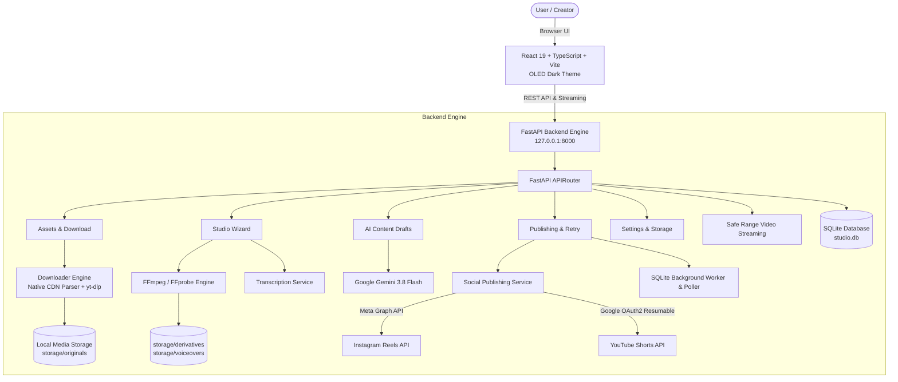

<p align="center">
  
</p>

<h1 align="center">Kuaishou Video Studio</h1>

<p align="center">
  <strong>High-performance, local-first desktop studio for macOS to download authorized Kuaishou (快手) / Kwai videos, dub with English voice-over tracks, burn subtitles, generate AI captions, and publish directly to Instagram Reels and YouTube Shorts.</strong>
</p>

<p align="center">
  <a href="https://fastapi.tiangolo.com"></a>
  <a href="https://react.dev"></a>
  <a href="https://vitejs.dev"></a>
  <a href="https://python.org"></a>
  <a href="https://ffmpeg.org"></a>
  <a href="https://ai.google.dev"></a>
  <a href="LICENSE"></a>
</p>

---

## 📑 Table of Contents

- [Key Highlights](#-key-highlights)
- [System Architecture](#-system-architecture)
- [The 6-Step Studio Workflow](#-the-6-step-studio-workflow)
- [Project Directory Layout](#-project-directory-layout)
- [Prerequisites & System Requirements](#-prerequisites--system-requirements)
- [Quick Start Guide](#-quick-start-guide)
- [Configuration & Credentials](#-configuration--credentials)
- [Automated Testing & Verification](#-automated-testing--verification)
- [REST API Specifications](#-rest-api-specifications)
- [Security & Privacy Model](#-security--privacy-model)
- [Graphify Architecture Knowledge Graph](#-graphify-architecture-knowledge-graph)
- [License](#-license)

---

## ✨ Key Highlights

- 🔒 **100% Local-First & Private:** All media files, SQLite databases, and API secrets remain strictly on your local Mac. Servers bind only to loopback (`127.0.0.1`).
- 🎯 **Preserve Original Video Frames:** The source video stream is never cropped, distorted, or re-framed. The original 9:16 vertical video framing is strictly maintained, and original files are kept completely untouched in `storage/originals/`.
- ⚡ **Dual-Engine Ingestion Pipeline:** 
  - **Primary:** High-speed native Kuaishou CDN stream parser (`window.INIT_STATE`) that follows mobile share links (`v.kuaishou.com`), pulls exact Chinese captions & author handles, and downloads high-definition `.mp4` video directly.
  - **Fallback:** Automatic failover to `yt-dlp` array execution.
- 🎙️ **Voice-Over Engine:** 
  - Upload user-supplied English voice-over MP4s.
  - Automatically extracts the audio track via FFmpeg, discarding unnecessary video tracks.
  - Completely mutes original Chinese audio by default.
  - Three synchronization policies: `keep_natural_speed` (recommended), `fit_to_video` (atempo/rubberband), or `manual_adjustment`.
- 📝 **Subtitle & Caption Generation:**
  - Automatic timestamped subtitle generation with local phrase segmentation.
  - In-browser interactive subtitle editor.
  - Subtitle burn-in with customizable font sizes, colors (`&H00FFFFFF`), and outline styles.
  - One-click `.srt` export.
- 🤖 **AI Content Assistant:**
  - Integrated with **Google Gemini 3.8 Flash** (`gemini-3.8-flash`) to generate platform-tailored, viral Instagram captions/hashtags and YouTube Shorts titles, descriptions, and tags.
  - Smart local heuristic fallbacks when offline or unconfigured.
- 🚀 **Multi-Platform Direct Publishing:**
  - **Instagram Reels:** Official Meta Graph API publishing with direct streaming ingestion.
  - **YouTube Shorts:** Google Cloud OAuth 2.0 resumable direct upload API (`youtube.upload` scope).
  - **Independent Platform Tracking:** Real-time statuses (`draft`, `scheduled`, `publishing`, `published`, `failed`).
  - **Single-Platform Retry:** Retry failed uploads on one platform without creating duplicate posts on successful ones.
- 📁 **Configurable Storage Directory:** Select custom media destination directories (e.g., `~/Movies/KuaishouStudio` or external SSD) directly from the Settings page with automatic directory creation and disk space meters.

---

## 🏛 System Architecture



---

## 🪄 The 6-Step Studio Workflow

The core studio wizard at `/studio` provides an intuitive 6-step guided experience:

| Step | Name | Description | Key Actions |
| :---: | :--- | :--- | :--- |
| **1** | **Select Source** | Choose an ingested Kuaishou/Kwai video asset from your local library. | Preview video, inspect duration, resolution (720×1280), and audio status. |
| **2** | **Voice-Over Sync** | Upload an English voice-over MP4 or toggle voice-over replacement on/off. | Mute original audio, extract audio from voice-over MP4, select sync policy (`keep_natural_speed`). |
| **3** | **Captions & Subtitles** | Review, edit, and burn English timestamped subtitles. | Edit caption text, adjust start/end timestamps, customize font size & color, export `.srt`. |
| **4** | **Preview & Export** | Inspect synchronized video with burned subtitles before exporting. | Real-time HTML5 video player with range-request streaming, render derivative MP4. |
| **5** | **AI Metadata** | Generate viral copy for target platforms using Gemini 3.8 Flash. | Customize tone (engaging, professional, humorous), generate Instagram captions/hashtags & YouTube titles/tags. |
| **6** | **Publish & Schedule** | Publish immediately or schedule to Instagram Reels, YouTube Shorts, or both. | Choose platforms, set local timezone-aware publication time, execute upload with real-time audit log. |

---

## 📂 Project Directory Layout

```
kasu pro/
├── run.sh                     # Convenience single-command launcher (Backend + Frontend)
├── backend.md                 # Backend engineering specification
├── frontend.md                # Frontend engineering specification
├── README.md                  # Comprehensive project documentation
├── .gitignore                 # Secure exclusion of .env, media files, and caches
│
├── backend/                   # Python FastAPI Backend
│   ├── .env                   # Local environment variables & API tokens (gitignored)
│   ├── .env.example           # Environment template with credential placeholders
│   ├── pyproject.toml         # Backend project configuration & dependencies
│   ├── app/
│   │   ├── main.py            # FastAPI lifespan, CORS, and loopback bindings
│   │   ├── api/
│   │   │   ├── router.py      # Unified API router
│   │   │   └── endpoints/     # assets, studio, drafts, publishing, settings, media
│   │   ├── core/
│   │   │   ├── config.py      # Dynamic storage & Pydantic application settings
│   │   │   ├── database.py    # SQLite engine and session factory
│   │   │   └── security.py    # SSRF guard, hostname allowlist, path traversal protection
│   │   ├── models/            # SQLAlchemy database models (VideoAsset, MediaDerivative, etc.)
│   │   ├── schemas/           # Pydantic v2 validation models & request/response contracts
│   │   └── services/          # Media (FFmpeg), Downloader, Transcription, AI, Publisher, Scheduler
│   └── tests/
│       ├── conftest.py        # Pytest database fixtures & social publisher quota mocking
│       ├── test_backend.py    # Unit tests for URL security, formatting, CRUD
│       └── test_full_workflow.py # End-to-end integration test (ingest -> sync -> captions -> publish)
│
├── frontend/                  # React 19 + TypeScript + Vite Frontend
│   ├── package.json           # Frontend dependencies & scripts
│   ├── vite.config.ts         # Vite server configuration & API proxy
│   ├── index.html             # App entry, dynamic title, & logo favicon
│   ├── public/                # Static studio assets
│   │   ├── logo.svg           # High-resolution vector brand mark
│   │   └── favicon.svg        # Browser tab favicon badge
│   ├── src/
│   │   ├── App.tsx            # Application routing shell
│   │   ├── index.css          # UI UX Pro Max OLED Dark theme tokens
│   │   ├── api/client.ts      # Strictly typed HTTP API client
│   │   ├── components/        # Sidebar navigation, Header, Logo, disk space badge
│   │   ├── pages/
│   │   │   ├── DashboardPage.tsx  # Ingestion dashboard & URL download queue
│   │   │   ├── LibraryPage.tsx    # Media asset management, filters, playback modal
│   │   │   ├── StudioPage.tsx     # 6-step guided video production wizard
│   │   │   ├── CalendarPage.tsx   # Timezone-aware scheduled post calendar
│   │   │   ├── HistoryPage.tsx    # Audit trail with single-platform retry
│   │   │   └── SettingsPage.tsx   # Storage directory selection, policies, OAuth status
│   │   └── types/             # TypeScript interfaces and domain types
│
├── storage/                   # Default local media workspace (gitignored)
│   ├── studio.db              # SQLite persistent database
│   ├── originals/             # Raw untouched downloaded source videos
│   ├── voiceovers/            # Uploaded voice-over MP4s & extracted audio tracks
│   ├── derivatives/           # Synchronized, captioned, and final exported MP4s
│   ├── thumbnails/            # Extracted high-resolution video covers
│   └── temp/                  # Temporary subtitle files (.srt, .vtt)
│
└── graphify-out/              # Architecture Knowledge Graph
    ├── graph.json             # 432 Nodes, 913 Edges graph data
    └── graph.html             # Interactive D3 visualization (open in browser)
```

---

## 💻 Prerequisites & System Requirements

- **Operating System:** macOS (Apple Silicon or Intel)
- **Python:** 3.12 or newer (Tested on Python 3.14)
- **Node.js:** 18 or newer (Tested on Node.js v22)
- **FFmpeg & FFprobe:** Installed and available in PATH:
  ```bash
  brew install ffmpeg
  ```
- **yt-dlp:** Installed and available in PATH:
  ```bash
  brew install yt-dlp
  ```

---

## ⚡ Quick Start Guide

### Option 1: One-Click Startup (Recommended)

Run the included executable script from the project root:

```bash
./run.sh
```

This automatically:
1. Validates that `ffmpeg` and `yt-dlp` are installed.
2. Creates any missing storage subdirectories.
3. Launches the FastAPI backend at `http://127.0.0.1:8000`.
4. Waits for the `/api/health` check to pass.
5. Launches the Vite development frontend at `http://localhost:5173`.

### Option 2: Manual Terminal Execution

#### 1. Backend Setup
```bash
cd backend
python3 -m venv .venv
source .venv/bin/activate
pip install -r requirements.txt   # or pip install fastapi uvicorn sqlalchemy pydantic pydantic-settings httpx yt-dlp pytest pytest-asyncio
PYTHONPATH=. uvicorn app.main:app --host 127.0.0.1 --port 8000 --reload
```

#### 2. Frontend Setup
```bash
cd frontend
npm install
npm run dev
```

- **Frontend Application:** [http://localhost:5173](http://localhost:5173)
- **Interactive Swagger Docs:** [http://127.0.0.1:8000/docs](http://127.0.0.1:8000/docs)
- **ReDoc API Documentation:** [http://127.0.0.1:8000/redoc](http://127.0.0.1:8000/redoc)

---

## 🔑 Configuration & Credentials

Create a `backend/.env` file based on `backend/.env.example`:

```env
# Storage & Database
DATABASE_URL=sqlite:///./storage/studio.db

# Server Bindings
HOST=127.0.0.1
PORT=8000
DEBUG=false

# Default Timezone & Preferences
DEFAULT_TIMEZONE=Asia/Kolkata
DEFAULT_SYNC_POLICY=keep_natural_speed
DEFAULT_SUBTITLE_FONT_SIZE=24
DEFAULT_SUBTITLE_FONT_COLOR=&H00FFFFFF

# Google Gemini AI Integration (Viral Metadata Copy)
GEMINI_API_KEY=your_gemini_api_key_here
GEMINI_MODEL=gemini-3.8-flash

# Instagram Reels Publishing (Meta Graph API)
INSTAGRAM_ACCOUNT_ID=your_instagram_user_or_business_id
INSTAGRAM_BUSINESS_ACCOUNT_ID=your_instagram_user_or_business_id
INSTAGRAM_ACCESS_TOKEN=your_meta_user_or_page_access_token

# YouTube Shorts Direct Upload (Google Cloud OAuth 2.0 Data API v3)
YOUTUBE_CLIENT_ID=your_oauth_client_id.apps.googleusercontent.com
YOUTUBE_CLIENT_SECRET=your_oauth_client_secret
YOUTUBE_REFRESH_TOKEN=your_oauth_refresh_token
```

> [!NOTE]
> All credentials can also be connected and inspected dynamically from the **Settings** page in the user interface.

---

## 🧪 Automated Testing & Verification

The test suite validates URL security guards, path sanitization, subtitle formatting, Gemini AI generation, and a complete end-to-end video lifecycle with synthetic 9:16 media generated via FFmpeg.

Automated tests mock external social publishing endpoints to ensure runs are fast and never consume live Meta or Google API quotas:

```bash
PYTHONPATH=backend backend/.venv/bin/pytest backend/tests/ -v
```

**Verification Results:**
```
backend/tests/test_backend.py::test_valid_kuaishou_urls PASSED            [  7%]
backend/tests/test_backend.py::test_reject_unsupported_domains PASSED     [ 15%]
backend/tests/test_backend.py::test_reject_invalid_schemes PASSED         [ 23%]
backend/tests/test_backend.py::test_sanitize_filename PASSED              [ 30%]
backend/tests/test_backend.py::test_path_traversal_guard PASSED           [ 38%]
backend/tests/test_backend.py::test_timestamp_formatting PASSED           [ 46%]
backend/tests/test_backend.py::test_srt_generation PASSED                 [ 53%]
backend/tests/test_backend.py::test_metadata_generation PASSED            [ 61%]
backend/tests/test_backend.py::test_health_check_endpoint PASSED          [ 69%]
backend/tests/test_backend.py::test_settings_endpoints PASSED             [ 76%]
backend/tests/test_backend.py::test_asset_crud_flow PASSED                [ 84%]
backend/tests/test_backend.py::test_publication_creation_and_independent_status PASSED [ 92%]
backend/tests/test_full_workflow.py::test_complete_end_to_end_video_workflow PASSED [100%]

======================== 13 passed in 9.11s ========================
```

---

## 📡 REST API Specifications

### Ingestion & Library (`/api/assets`)
- `POST /api/assets/inspect` — Validate Kuaishou URL, follow redirects, check duplicates, extract Chinese title & duration.
- `POST /api/assets/download` — Download video via native CDN stream or yt-dlp, compute SHA256, probe media with FFprobe.
- `GET /api/assets` — List all ingested video assets with search and status filters.
- `GET /api/assets/{id}` — Retrieve detailed asset metadata, voice-overs, and generated derivatives.
- `DELETE /api/assets/{id}` — Safely delete an asset and all its derivative files from disk.

### Video Studio (`/api/studio`)
- `POST /api/studio/upload-voiceover` — Upload English voice-over MP4, extract audio stream, validate duration.
- `POST /api/studio/sync-voiceover` — Mute original audio, merge voice-over audio, create synced derivative.
- `GET /api/studio/{asset_id}/transcript` — Retrieve timestamped subtitle segments for the voice-over.
- `PUT /api/studio/{asset_id}/transcript` — Save updated subtitle segments.
- `POST /api/studio/burn-subtitles` — Burn subtitles into video derivative using FFmpeg with custom styling.
- `POST /api/studio/export` — Render and finalize production-ready vertical 9:16 derivative.

### AI Metadata Assistant (`/api/drafts`)
- `POST /api/drafts/generate` — Generate platform copy via Gemini 3.8 Flash (Instagram captions & YouTube titles/tags).
- `GET /api/drafts/{asset_id}` — Retrieve saved draft copy for an asset.
- `PUT /api/drafts/{draft_id}` — Update titles, captions, descriptions, or hashtags.

### Publishing & Scheduling (`/api/publications`)
- `POST /api/publications` — Publish immediately or schedule to Instagram Reels, YouTube Shorts, or both.
- `GET /api/publications` — List all publications with platform and status filters.
- `POST /api/publications/{id}/retry` — Retry a single failed publication without duplicating successful posts.
- `DELETE /api/publications/{id}/cancel` — Cancel a scheduled publication.

### Settings & Media Streaming (`/api/settings` & `/api/media`)
- `GET /api/settings` — Get active storage directory, available disk space, and tool statuses.
- `PUT /api/settings` — Update storage directory, timezone, sync policy, or subtitle appearance.
- `GET /api/settings/accounts` — Check connected Instagram and YouTube accounts.
- `GET /api/media/video/{id}` — Stream original video with HTTP 206 range-request support.
- `GET /api/media/derivative/{id}` — Stream finished derivative MP4.
- `GET /api/media/thumbnail/{id}` — Serve asset cover thumbnail image.

---

## 🛡️ Security & Privacy Model

1. **Loopback Server Binding:** The backend binds strictly to `127.0.0.1:8000`, preventing unauthorized network access from other devices on the local area network.
2. **SSRF Guard:** Ingestion URLs are strictly validated against an allowlist of official Kuaishou/Kwai domains (`v.kuaishou.com`, `kuaishou.com`, `kwai.com`, `chenzhongtech.com`). DNS resolution blocks private, loopback, and link-local IP addresses.
3. **Path Traversal Guards:** File streaming and storage lookups use `safe_resolve_path` to guarantee that all requested file paths are strictly contained within the allowed storage roots.
4. **Credential Isolation:** OAuth secrets, refresh tokens, and AI keys are never committed to version control and are never exposed in client browser JavaScript bundles.

---

## 🗺️ Graphify Architecture Knowledge Graph

The project codebase maintains a persistent architectural knowledge graph generated by **Graphify**:

- **Current Graph Metrics:** 432 Nodes · 913 Edges · 47 Communities
- **Interactive Visualization:** Open [graphify-out/graph.html](graphify-out/graph.html) directly in any browser for an interactive D3 graph of code relationships, dependencies, and data flows.

To refresh the graph after making changes:
```bash
graphify extract . --code-only && graphify export html
```

---

## 📄 License

This project is licensed under the [MIT License](LICENSE). Authorized for lawful video downloading, translation, and creator syndication.
